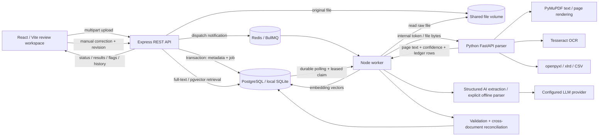

# Architecture

The upload transaction commits metadata, history and a durable job before returning 202. Redis is a dispatch accelerator; database polling is the recovery path. The API does no OCR or extraction. Workers claim one job at a time with a unique lease token, heartbeat every 30 seconds and reclaim after a two-minute expired lease. Result commits verify lease ownership. Transient failures retry up to three attempts, while parser-invalid documents fail explicitly. The worker process is separate from the API and can be scaled in PostgreSQL mode.

Parsing processes each PDF page independently. Text layers are preferred; near-empty pages are rendered for OCR. Image formats include TIFF frames. All spreadsheet sheets are retained, with tabular invoice ledgers materialized as individual expected records. Row, decompression, pixel, file-size, text and page limits are explicit.

The extraction adapter validates every model result against a strict invoice schema, records the prompt/response and retries invalid schema output once. Large documents use bounded calls and conservative merging. Validation runs within the result transaction; cross-document flags are recomputed in both directions under a reconciliation lock. Corrections preserve source files and record before/after data. Embedding refreshes are separate background jobs after manual corrections.

Local mode swaps PostgreSQL for durable SQLite and omits Redis without changing API behavior. Semantic retrieval remains explicitly unavailable without PostgreSQL, embeddings and a provider key.
