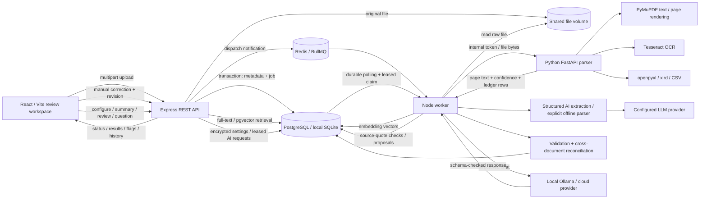

# Architecture

The upload transaction commits metadata, history and a durable job before returning 202. Redis is a dispatch accelerator; database polling is the recovery path. The API does no OCR or extraction. Workers claim one job at a time with a unique lease token, heartbeat every 30 seconds and reclaim after a two-minute expired lease. Result commits verify lease ownership. Transient failures retry up to three attempts, while parser-invalid documents fail explicitly. The worker process is separate from the API and can be scaled in PostgreSQL mode.

Parsing processes each PDF page independently. Text layers are preferred; near-empty pages are rendered for OCR. Image formats include TIFF frames. All spreadsheet sheets are retained, with tabular invoice ledgers materialized as individual expected records. Row, decompression, pixel, file-size, text and page limits are explicit.

The extraction adapter validates every model result against a strict invoice schema, records the prompt/response and retries invalid schema output once. Large documents use bounded calls and conservative merging. Validation runs within the result transaction; cross-document flags are recomputed in both directions under a reconciliation lock. Corrections preserve source files and record before/after data. Embedding refreshes are separate background jobs after manual corrections.

Local mode swaps PostgreSQL for durable SQLite and omits Redis without changing API behavior. Semantic retrieval remains explicitly unavailable without PostgreSQL, embeddings and a provider key.

AI connection settings are workspace-wide. API requests enqueue a connection test and return 202; the worker switches settings only after receiving valid structured output. Ollama uses native `/api/chat` with a JSON Schema, `stream:false`, `think:false` and temperature zero. Cloud providers use `/chat/completions` with strict schema or JSON mode. The worker reads current settings for each document/assistant task and records the actual provider/model. Stored settings override environment defaults.

`ai_runs` is a second leased database queue for connection tests and assistant requests. Document jobs currently have priority. It uses atomic claims, two-minute leases, 30-second heartbeats, retry recovery after worker crashes and ownership checks before committing. Disabling AI cancels pending/in-flight AI requests and fences late activation/results; already-running document extraction may finish. PostgreSQL advisory lock 691216 serializes configuration activation and disabling. Normal document-job retry behavior remains separate.

The assistant reads up to twelve 1,100-character source excerpts selected by lexical relevance, including up to three documents linked by existing validation flags. It is not a semantic vector retriever. Source IDs, page/sheet metadata, structured values and validation results accompany the request. Exact source quotes are checked before returning citations. Scalar proposals need quoted support; calculated monetary proposals must match known operands and 0.01 tolerance. Proposals never write invoice values. React opens a draft and uses the existing revision-protected correction route only after a user saves. AI results retain the document revision and become stale after correction/reprocessing.

Cloud keys are AES-256-GCM encrypted with a shared environment secret or generated data-volume key. Public settings/run responses omit raw inputs, audits and credentials. Source text and raw model output remain in server-side audits. Model addresses reject secret-bearing URLs and unapproved private endpoints; explicit local host addresses support Ollama and local compatible servers. Provider redirects are disabled. This remains a shared-workspace access model, not per-user credentials or tenant isolation.
