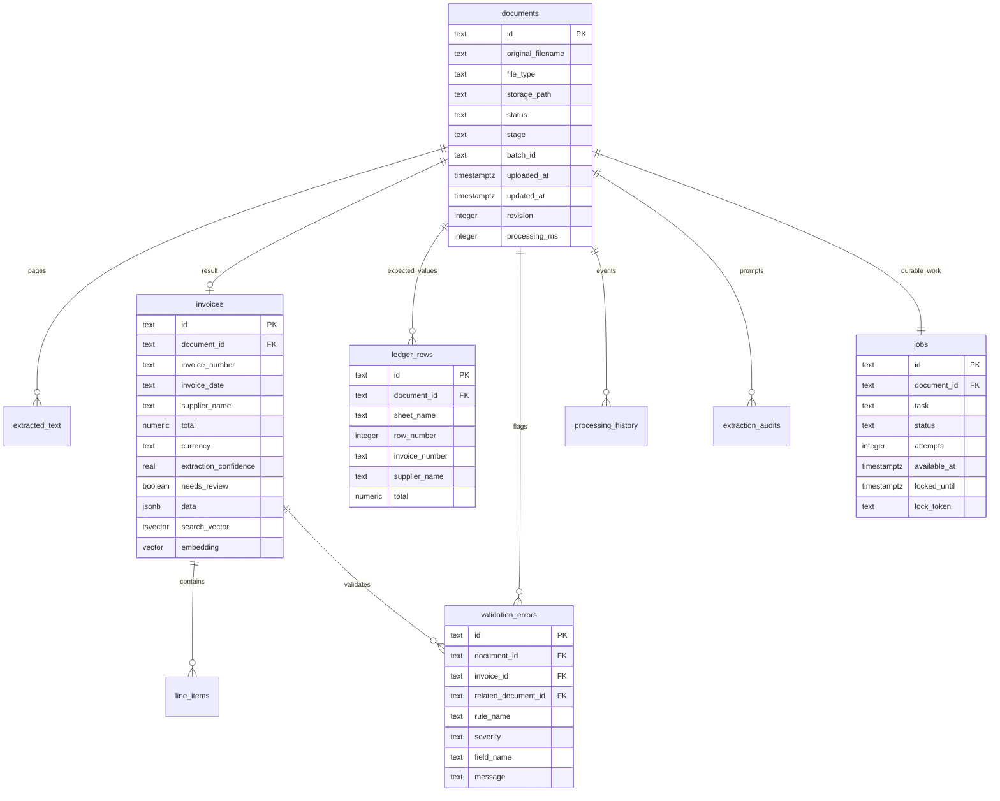

# Database schema

The executable schema and migrations are in `apps/api/src/db/schema.js` and `index.js`. UUIDs are stored as text to share identifiers with SQLite; financial amounts use exact `NUMERIC(18,4)` in PostgreSQL. Invalid source dates remain text until validation, so they can be reviewed instead of crashing inserts. Foreign keys cascade on document removal. Document status/severity/job status constraints reject invalid lifecycle values. All referencing foreign keys used for retrieval have indexes.

`invoices.data` keeps the schema-validated object used by corrections and APIs; scalar columns and normalized line items are written in the same transaction. `search_text` includes all line-item descriptions. PostgreSQL derives `search_vector` with the immutable explicit `simple` dictionary and indexes it with GIN. `embedding vector(1536)` uses an HNSW cosine index. SQLite uses escaped substring keyword search and does not pretend to provide semantic retrieval.

`schema_migrations` records applied versions. Migrations execute under a transaction and PostgreSQL advisory lock. Jobs are unique per document and contain a task (`process` or `embedding`), due time, attempts and lease identity. The outbox survives API/worker restarts and failed Redis notifications. Prompt audits are separate from general activity history because they contain full document text and provider responses.
